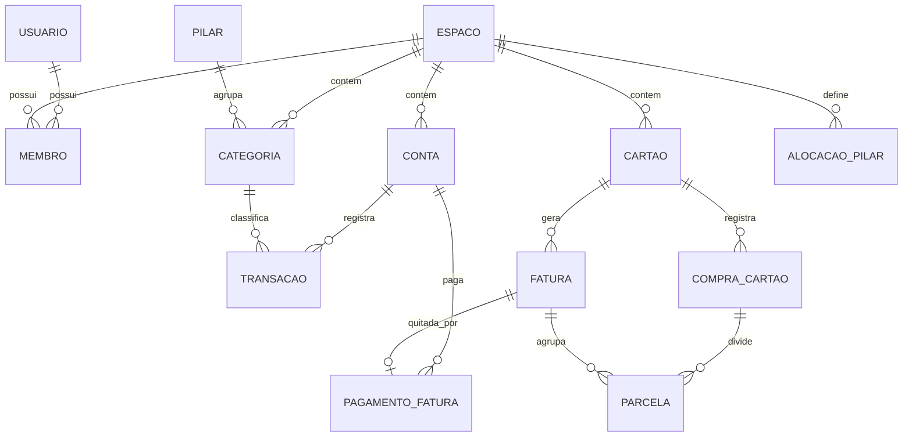

# Planejamento — Aplicativo de Controle Financeiro Pessoal

> Documento de planejamento. Nenhuma linha de código ainda — este arquivo é a base para o desenvolvimento futuro.
> Data: 19/07/2026

---

## 1. Visão geral

Aplicativo de controle financeiro pessoal com foco no contexto brasileiro (BRL, cartão de crédito com fatura e parcelamento). Uso inicial pessoal, mas projetado desde o início para múltiplos usuários (ex.: compartilhar com família/cônjuge no futuro).

**Objetivos principais:**
- Registrar receitas, despesas e transferências manualmente com o mínimo de fricção.
- Organizar as despesas pelo método dos **6 pilares de alocação da renda** (Custos Fixos, Conforto, Metas, Prazeres, Liberdade Financeira e Conhecimento), acompanhando o % da renda em cada pilar contra um alvo definido.
- Modelar cartão de crédito de forma realista: faturas, fechamento/vencimento e compras parceladas.
- Dar visibilidade clara: saldo por conta, gastos por categoria, evolução mensal e fatura prevista.
- Rodar em infraestrutura própria (self-host), com dados 100% sob controle do usuário.

## 2. Decisões definidas

| Tema | Decisão |
|---|---|
| Plataforma | Web + mobile, com backend compartilhado. Web primeiro; mobile em fase posterior consumindo a mesma API. |
| Entrada de dados | Lançamento manual (importação de extratos e Open Finance ficam no roadmap). |
| Categorização | **6 pilares fixos e obrigatórios** — Custos Fixos, Conforto, Metas, Prazeres, Liberdade Financeira e Conhecimento — com categorias/subcategorias livres dentro de cada um. |
| Escopo | MVP enxuto porém com cartão de crédito completo, + roadmap detalhado por fases. |
| Stack | Front-end em React/TypeScript; back-end em **Java 21 + Spring Boot** (preferência do autor e objetivo de reforçar a stack). |
| Cartão de crédito | Faturas, parcelas e ciclo fechamento/vencimento **já no MVP**. |
| Usuários | Multiusuário desde o início, com conceito de "espaço" compartilhado. |
| Hospedagem | Self-host em **Proxmox**: LXC dedicado ao app rodando Docker Compose; acesso remoto via WireGuard (em outro servidor da mesma rede) e **DNS interno** com HTTPS. |

## 3. Arquitetura e stack

### 3.1 Visão recomendada

```
┌─────────────┐     ┌──────────────────┐
│  Web (PWA)  │     │ Mobile (fase 4)  │
│  React + TS │     │ React Native/Expo│
└──────┬──────┘     └────────┬─────────┘
       │   HTTPS / REST      │
       │  (cliente TS gerado do OpenAPI)
       └──────────┬───────────┘
            ┌─────▼──────┐
            │    API     │  Java 21 + Spring Boot 3
            │ Spring Boot│  (Web, Data JPA, Security, Validation)
            └─────┬──────┘
            ┌─────▼─────┐
            │ PostgreSQL│  + Flyway (migrações)
            └───────────┘
        Tudo em Docker Compose (self-host)
```

### 3.2 Escolhas e justificativas

- **Back-end: Java 21 (LTS) + Spring Boot 3** — Spring Web, Spring Data JPA, Spring Security e Bean Validation. Domínio transacional sobre banco relacional é o caso de uso clássico do Spring, e a estrutura controller/service/repository organiza bem as regras de fatura/parcela (seção 5). Escolha reforçada pela preferência do autor pela stack.
- **Migrações com Flyway**, versionadas desde o dia 1.
- **Contrato OpenAPI como ponte entre as linguagens**: springdoc-openapi gera a especificação a partir dos controllers; no front, `orval` (ou `openapi-typescript`) gera cliente TypeScript tipado (com hooks React Query). Isso recupera a segurança de tipos ponta a ponta que se perderia por não ter TS dos dois lados — mudou o contrato na API, o build do front quebra.
- **Frontend web: React + Vite + TypeScript** (SPA/PWA). Como o app é autenticado e pessoal, SSR não traz benefício; um SPA instalável como PWA cobre o uso no celular até o app nativo existir.
- **PostgreSQL**: relacional é a escolha natural para dados financeiros (integridade referencial, transações ACID, agregações).
- **Autenticação**: Spring Security com e-mail + senha e sessão via cookie httpOnly (ou JWT curto + refresh). Sem dependência de serviço externo, coerente com self-host. 2FA opcional no roadmap.
- **Testes**: JUnit 5 + Testcontainers (sobe um Postgres real por teste de integração) — as regras de fatura/parcelamento merecem cobertura de teste desde o início.
- **Estrutura do repositório**: repo único com `api/` (projeto Java), `web/` (Vite + React), `mobile/` (futuro) e `docker/` (compose + configs).
- **Deploy**: `docker-compose.yml` com serviços `caddy` (proxy + TLS), `api` (jar em imagem JRE 21), `web` (build React servido pelo Caddy) e `postgres`, + backup agendado do banco. Nenhuma porta exposta à internet pública. Detalhes da infraestrutura na seção 3.4.

### 3.3 Idioma do código e internacionalização (i18n)

**Código-fonte 100% em inglês** — classes, métodos, variáveis, tabelas, colunas, endpoints, chaves de enum, commits e comentários. Como o domínio é brasileiro, fica definido o **glossário oficial PT → EN**, a ser usado sempre e sem variações:

| Domínio (PT) | Código (EN) |
|---|---|
| Espaço | `Workspace` |
| Membro | `Member` |
| Conta | `Account` |
| Transação / lançamento | `Transaction` |
| Transferência | `Transfer` |
| Aporte | `Contribution` |
| Categoria | `Category` |
| Pilar | `Pillar` — enum `FIXED_COSTS`, `COMFORT`, `GOALS`, `PLEASURES`, `FINANCIAL_FREEDOM`, `KNOWLEDGE` |
| Alocação por pilar | `PillarAllocation` |
| Cartão de crédito | `Card` |
| Compra no cartão | `CardPurchase` |
| Parcela | `Installment` |
| Fatura | `Statement` |
| Dia de fechamento / vencimento | `closingDay` / `dueDay` |
| Pagamento de fatura | `StatementPayment` |
| Caixinha (roadmap) | `Vault` |

**Preparado para i18n desde o dia 1, com pt-BR como idioma padrão:**
- **Front-end**: nenhuma string hardcoded — todo texto via chave de tradução (react-i18next), formato ICU para plurais; moeda e datas formatadas com `Intl` (locale `pt-BR`, moeda BRL).
- **API**: erros retornam **código de máquina + parâmetros** (ex.: `STATEMENT_ALREADY_PAID`) e o front traduz — o backend não fica acoplado a idioma; mensagens de validação (Bean Validation) via `MessageSource` como fallback.
- **Banco de dados**: nunca armazenar rótulo traduzível — enums gravados como chave (`FIXED_COSTS`, traduzida na UI); as categorias do seed são dados do usuário, criadas no idioma do espaço no momento do cadastro.
- Locale por usuário (padrão `pt-BR`), negociado via `Accept-Language`.

### 3.4 Infraestrutura self-host (Proxmox, WireGuard e DNS interno)

Topologia real do ambiente:

```
Celular/notebook fora de casa
        │ túnel WireGuard (UDP)
        ▼
Servidor VPN (outro host da mesma rede)
        │
   Rede local ── DNS interno (ex.: financas.<domínio>)
        │
Proxmox (Ryzen 5 5600, 16 GB RAM, HDD 1 TB)
   └── LXC dedicado ao app
         └── Docker Compose: caddy │ api │ web │ postgres
```

- **LXC dedicado** ao app no Proxmox, rodando Docker Compose. Habilitar `nesting=1` (e `keyctl=1`) nas opções do LXC para o Docker funcionar; se preferir isolamento total, uma VM leve é a alternativa.
- **Backup em duas camadas**: dump diário do Postgres (serviço no próprio compose) **+** backup do LXC inteiro pelo Proxmox (vzdump ou Proxmox Backup Server) com destino fora do HDD principal — isso resolve o risco do disco mecânico apontado na revisão.
- **Acesso remoto**: como o WireGuard está em outro servidor da mesma rede, o app não precisa de nada especial — basta o `AllowedIPs` dos clientes incluir a subnet da LAN e o DNS do túnel apontar para o DNS interno. O mesmo hostname funciona dentro e fora de casa.
- **DNS interno**: registrar um hostname para o app (ex.: `financas.home.<seu-domínio>.com`) no DNS da rede — Pi-hole, AdGuard Home, dnsmasq ou o próprio roteador — apontando para o IP do LXC. Evitar TLDs inventados (`.lan`, `.local`): usar subdomínio de um domínio real ou `home.arpa` (reservado para redes domésticas).
- **HTTPS é obrigatório** — PWA só instala e registra service worker em contexto seguro. Sem nada exposto à internet, há duas opções:
  - **(a) Recomendada**: possuir um domínio real (custa ~R$ 40/ano) e emitir certificado Let's Encrypt via **desafio DNS-01** — o Caddy automatiza, inclusive wildcard, sem abrir porta nenhuma. Certificado válido em qualquer dispositivo, zero configuração nos clientes.
  - **(b)** CA interna do Caddy (`tls internal`), instalando o certificado raiz manualmente em cada dispositivo — sem custo, mas com atrito a cada aparelho novo.

## 4. Modelo de dados (MVP)

> Nota: as entidades abaixo usam nomes em português para facilitar a leitura do documento; **no código valem os nomes em inglês** do glossário da seção 3.3.

Conceito central: **Espaço (workspace)** — todo dado financeiro pertence a um espaço, e usuários são membros de espaços. É isso que torna o multiusuário natural: seu uso pessoal é um espaço com um membro; compartilhar com alguém é adicionar um membro.



### Entidades

- **Usuario**: id, nome, e-mail, hash de senha, criado_em.
- **Espaco**: id, nome. **Membro**: usuario_id, espaco_id, papel (`dono` | `membro`).
- **Conta**: espaco_id, nome, tipo (`corrente` | `poupanca` | `dinheiro` | `investimento` | `outra`), saldo_inicial, cor/ícone, arquivada. Contas de tipo `investimento`/`poupanca` podem indicar um `pilar_aporte` (Liberdade Financeira, Metas ou Conhecimento) — ver regra 9.
- **Pilar** (enum fixo, não editável nem excluível): **Custos Fixos, Conforto, Metas, Prazeres, Liberdade Financeira, Conhecimento**. Toda categoria de despesa pertence obrigatoriamente a um pilar.
- **Categoria**: espaco_id, pilar (obrigatório quando tipo = `despesa`), nome, tipo (`receita` | `despesa`), categoria_pai (subcategorias), cor/ícone. Categorias de receita não têm pilar. Seed inicial já distribuído nos pilares (ex.: Aluguel, Mercado, Luz → Custos Fixos; iFood, streaming → Prazeres; livros, cursos → Conhecimento; assinatura de academia → Conforto…).
- **AlocacaoPilar**: espaco_id, pilar, percentual_alvo. No MVP os valores são fixos: **Custos Fixos 30%, Conforto 10%, Metas 20%, Prazeres 10%, Liberdade Financeira 25%, Conhecimento 5%** (a entidade já existe para viabilizar a personalização prevista na Fase 2).
- **Transacao**: espaco_id, conta_id, categoria_id, tipo (`receita` | `despesa` | `transferencia`), valor (**inteiro em centavos**), data, descrição, observação, status (`efetivada` | `pendente`), transferencia_par_id (transferência = par de lançamentos espelhados).
- **Cartao**: espaco_id, nome, bandeira, limite, **dia_fechamento**, **dia_vencimento**, conta_pagamento_padrao_id, cor, arquivado.
- **CompraCartao**: cartao_id, categoria_id, descrição, valor_total, data_compra, total_parcelas.
- **Parcela**: compra_id, numero, valor, fatura_id. Criadas todas no ato da compra, alocadas às faturas futuras.
- **Fatura**: cartao_id, mês de referência, data_fechamento, data_vencimento, status (`aberta` | `fechada` | `paga` | `parcial`).
- **PagamentoFatura**: fatura_id, conta_id, valor, data — gera a despesa na conta de origem.

## 5. Regras de negócio essenciais

Estas regras são o coração do app e onde a maioria dos apps de finanças erra:

1. **Dinheiro em centavos (inteiro)** — nunca float. Toda soma/divisão de parcelas em inteiros; a última parcela absorve o resto da divisão (ex.: R$ 100 / 3 = 33,33 + 33,33 + 33,34).
2. **Compra no cartão não é despesa na conta** — ela afeta a fatura. A despesa "de verdade" na conta acontece no **pagamento da fatura**. Porém, nos **relatórios por categoria**, o gasto conta na data da compra (competência), senão o relatório mensal vira só "pagamento de fatura".
3. **Alocação de fatura**: compra até o dia de fechamento entra na fatura corrente; após o fechamento, na seguinte. Parcelas caem em faturas consecutivas.
4. **Transferência entre contas não é receita nem despesa** — não pode aparecer em relatórios de gasto, apenas mover saldo.
5. **Saldo de conta** = saldo_inicial + Σ transações efetivadas. Transações pendentes (agendadas) aparecem como "saldo projetado".
6. **Edição de parcelamento**: editar/excluir uma compra parcelada afeta todas as parcelas não pagas; faturas já pagas são imutáveis (correções via lançamento de ajuste).
7. **Datas em timezone local (America/Sao_Paulo)** armazenadas como data (não timestamp UTC), evitando compras "pulando" de dia/fatura.
8. **Isolamento por espaço**: toda query filtra por espaco_id — regra de autorização central da API.
9. **Aporte conta como alocação, não como despesa**: transferir dinheiro para uma conta de investimento/reserva não é despesa (regra 4), mas **precisa contar no pilar** (Liberdade Financeira, Metas ou Conhecimento) no relatório de alocação do mês — senão esses pilares nunca "consomem" seu percentual e o método não fecha. São esses três porque o dinheiro deles é **guardado antes de ser gasto**; Custos Fixos, Conforto e Prazeres se consomem no próprio gasto, e reservar dinheiro para eles contaria a mesma quantia duas vezes. Daí o campo `pilar_aporte` na conta: transferências destinadas a ela entram no cálculo de alocação do pilar, sem virar despesa. O pilar padrão vem da conta, mas pode ser ajustado em cada transferência — a mesma conta de corretora pode receber aporte de Metas num mês e de Liberdade Financeira no outro. (Na Fase 2, com as Caixinhas, o pilar passa a vir da caixinha de destino do aporte.)
10. **Base do cálculo de alocação**: % de cada pilar = (despesas do pilar no mês + aportes do pilar, por competência) ÷ receitas do mês. Meses sem receita (ou atípicos) mostram o valor absoluto com aviso, em vez de percentuais distorcidos.

## 6. Escopo do MVP (Fase 1)

### 6.1 Autenticação e espaços
- Cadastro/login com e-mail e senha; sessão persistente.
- Criação automática de espaço pessoal no cadastro; convite de membros por e-mail/link.

### 6.2 Contas
- CRUD de contas com saldo inicial, tipo (corrente, poupança, dinheiro, **investimento**, outra), cor/ícone; arquivar (não excluir se houver transações).
- Contas de investimento/reserva definem um **pilar de aporte padrão** (Liberdade Financeira, Metas ou Conhecimento).
- Saldo atual e projetado por conta; saldo total do espaço (com e sem investimentos).

### 6.3 Transações
- Lançar receita/despesa: valor, data, conta, categoria, descrição — em no máximo ~5 toques.
- Transferência entre contas.
- **Aporte**: transferência para conta de investimento/reserva — não conta como despesa, mas consome o percentual do pilar escolhido (pré-preenchido com o pilar padrão da conta, ajustável no lançamento entre Liberdade Financeira, Metas e Conhecimento).
- Transação pendente/agendada (ex.: conta a pagar) com efetivação em um clique.
- Listagem com filtros (período, conta, categoria, tipo, texto) e edição/exclusão.

### 6.4 Pilares e categorias
- Os 6 pilares fixos (Custos Fixos, Conforto, Metas, Prazeres, Liberdade Financeira, Conhecimento) — não editáveis, não excluíveis.
- CRUD de categorias e subcategorias de despesa dentro dos pilares, e categorias de receita (sem pilar); cores/ícones; seed padrão editável.
- Percentuais-alvo por pilar fixos no MVP: **30/10/20/10/25/5** (Custos Fixos, Conforto, Metas, Prazeres, Liberdade Financeira, Conhecimento). Personalização na Fase 2.

### 6.5 Cartão de crédito (completo no MVP)
- CRUD de cartões com limite, dia de fechamento e de vencimento.
- Lançar compra à vista ou parcelada (parcelas geradas e alocadas automaticamente).
- Tela da fatura: aberta/fechada/futuras, itens, total, limite disponível.
- Pagamento de fatura (total ou parcial) debitando uma conta.

### 6.6 Dashboard
- **Alocação por pilar** (visão central do método): % da renda do mês consumido em cada um dos 6 pilares vs percentual-alvo, com barras de progresso e destaque de estouro.
- Saldo total e por conta; receitas × despesas do mês.
- Gastos por categoria dentro de cada pilar (drill-down); faturas abertas e próximos vencimentos.
- Comparativo com o mês anterior.

### 6.7 Fundamentos técnicos do MVP
- PWA instalável, responsivo, tema claro/escuro.
- i18n desde o dia 1: todas as strings via chave de tradução, pt-BR como único idioma publicado no MVP.
- Docker Compose completo + **backup automático do Postgres** (dump diário com retenção).
- Exportação CSV das transações (portabilidade dos dados desde o início).

## 7. Roadmap

### Fase 2 — Planejamento financeiro
- **Personalização dos percentuais-alvo dos pilares**: editar os valores fixos do MVP (30/10/20/10/25/5) por espaço, com validação de soma = 100%.
- **Orçamento mensal por categoria** com barra de progresso e alerta de estouro — desce ao nível de categoria a visão por pilar que o MVP já entrega.
- **Recorrências**: assinaturas, salário, aluguel — lançamentos automáticos ou sugeridos, com visão "gastos fixos vs variáveis".
- **Caixinhas** — subdivisões virtuais de contas de investimento/reserva: o saldo real da conta (que no banco é um montante único) se reparte logicamente entre caixinhas (ex.: "Reserva de emergência", "Viagem 2027", "Aposentadoria") + uma fatia "não alocado". Cada caixinha define seu pilar (Metas, Liberdade Financeira ou Conhecimento) — o pilar do aporte passa a vir da caixinha de destino, refinando a regra 9 — e pode ter valor-alvo e prazo com barra de progresso e projeção (isso absorve o conceito de "metas de economia"). Inclui: aporte/resgate por caixinha, movimentação entre caixinhas sem sair da conta, composição da conta por caixinha no dashboard e lançamento de rendimento distribuível entre caixinhas.
- **Calendário financeiro**: contas a pagar/receber, vencimentos de fatura.
- Tags livres nas transações (além de categoria).

### Fase 3 — Produtividade e análise
- **Importação de extratos CSV/OFX** com deduplicação e categorização assistida (regras: "contém IFOOD → Alimentação").
- **Relatórios avançados**: evolução patrimonial, média por categoria, ranking de gastos, comparativos anuais.
- Anexos/comprovantes nas transações (foto de nota fiscal).
- Busca global; duplicar transação; lançamento rápido por template.
- Notificações (e-mail/push PWA): fatura fechando, conta vencendo, orçamento estourando.
- **Simulador de renda fixa** (módulo independente — pode ser antecipado, pois não depende do modelo de transações):
  - **Entradas**: tipo de investimento (CDB, LCI, LCA, LC, Tesouro Selic/Prefixado/IPCA+, poupança), rentabilidade conforme o indexador (prefixado % a.a. | pós-fixado % do CDI | híbrido IPCA + x%), valor inicial, aportes mensais (opcional) e prazo.
  - **Saídas**: valor bruto ao final, rendimento bruto, **IR pela tabela regressiva** quando incide (22,5% até 180 dias, 20% até 360, 17,5% até 720, 15% acima — sobre o rendimento, em CDB/LC/Tesouro; **LCI, LCA e poupança são isentos** para pessoa física), IOF regressivo se resgate < 30 dias, taxa de custódia B3 no Tesouro (0,20% a.a.), **valor líquido e rentabilidade líquida equivalente**.
  - **Comparador**: dois investimentos lado a lado respondendo "qual rende mais líquido?" (ex.: LCI 90% do CDI isenta vs CDB 110% do CDI com IR).
  - **Taxas de mercado** (CDI, Selic, IPCA) buscadas automaticamente da API pública e gratuita do Banco Central (SGS), com possibilidade de edição manual — coerente com self-host, sem dependência paga.

### Fase 4 — Mobile e integrações
- **App mobile React Native/Expo** consumindo a mesma API (o PWA cobre o celular até aqui).
- **Open Finance** via agregador (Pluggy/Belvo) — sincronização automática de transações (avaliar custo).
- Investimentos: posições simples de renda fixa (CDB, Tesouro) e patrimônio consolidado — reaproveitando o motor do simulador (Fase 3) para projetar o valor no vencimento de cada posição. Ações/renda variável entram na Fase 5, com o módulo IR.
- 2FA; múltiplos espaços por usuário (pessoal + casal); modo somente-leitura para membro.
- Novos idiomas (ex.: inglês) — custo baixo graças ao i18n estruturado desde o MVP.

### Fase 5 — Ações e Imposto de Renda (absorção do app IR)

Já existe um app funcional na pasta `IR/` — backend Spring Boot + Maven e front React + Vite + shadcn/ui, **mesma stack deste plano e código já em inglês** — que registra ordens de ativos e apura ganho de capital. Nesta fase ele deixa de ser um app separado e vira um módulo do controle financeiro:

- **Absorção, não integração**: o código de `IR/backend` e `IR/app` é movido/adaptado para a estrutura do novo repositório (`api/` e `web/`), passando a usar o login único e o modelo multiusuário por espaço (dados migram de `user_id` para o espaço).
- **Funcionalidades herdadas do IR**: cadastro de ativos BR e US (ações, FIIs, ETFs, UNITs, REITs), ordens de compra/venda e eventos corporativos (desdobramento, grupamento, bonificação, amortização), cálculo de preço médio e posições, apuração de ganho de capital e conversão PTAX (BCB) para ativos no exterior.
- **Auxílio à declaração anual de IR de ações** (objetivo central da fase): relatório de apoio com posição em 31/12 a custo de aquisição (ficha Bens e Direitos), apuração mensal de ganhos com controle da isenção de vendas até R$ 20 mil/mês em ações BR, compensação de prejuízos acumulados e tratamento de ativos no exterior via PTAX.
- **Integração com o restante do app**: a compra de ação pode ser vinculada a um aporte/caixinha já lançado — o dinheiro saiu da conta de investimento e o pilar já foi contabilizado na transferência, evitando dupla contagem na alocação; as posições de ações entram no patrimônio consolidado da Fase 4.

## 8. Funcionalidades que você não mencionou (recomendações)

Levantamento de lacunas comuns em apps de finanças pessoais — já posicionadas nas fases acima:

| Funcionalidade | Por que importa | Fase |
|---|---|---|
| Transferência entre contas | Sem ela, mover dinheiro vira receita+despesa falsa e infla relatórios | MVP |
| Transação pendente/agendada | Contas a pagar e previsão de saldo | MVP |
| Ajuste de saldo (reconciliação) | O saldo real do banco sempre diverge em algum momento; precisa de "corrigir saldo" em 1 clique | MVP |
| Backup automático | Self-host sem backup = risco real de perder todo o histórico | MVP |
| Exportação CSV | Portabilidade e análises externas (planilha) | MVP |
| Recorrências/assinaturas | Grande parte dos gastos é fixa; lançar manualmente todo mês cansa e leva ao abandono do app | Fase 2 |
| Orçamento por categoria | Transforma registro passivo em controle ativo | Fase 2 |
| Calendário de vencimentos | Evita juros por esquecimento | Fase 2 |
| Regras de categorização | Reduz drasticamente a fricção da importação | Fase 3 |
| Anexo de comprovantes | Útil para garantias, reembolsos e IR | Fase 3 |
| Notificações | Fatura fechando / conta vencendo | Fase 3 |

**Decisões conscientes de deixar de fora (por ora):** multi-moeda (só BRL), split de transação em múltiplas categorias, faturas em moeda estrangeira/IOF, empréstimos e financiamentos como módulo próprio, relatório para IR. Podem entrar no futuro, mas não devem atrasar o MVP.

## 9. Decisões de projeto (revisadas em 19/07/2026)

| # | Tema | Decisão |
|---|---|---|
| 1 | Nome do app | ✅ **MK Finance** — pasta `mk-finance/`, pacote `br.com.mkfinance`, infra/hostname `mkfinance`. |
| 2 | UI kit | ✅ **shadcn/ui + Tailwind** — mesmo kit já usado no app IR, tornando a absorção da Fase 5 quase transparente no front. |
| 3 | Build Java | ✅ **Maven** — consistência com o app IR existente. |
| 4 | Acesso externo | ✅ **VPN WireGuard** — o app não fica exposto à internet pública; acesso fora de casa via túnel. |
| 5 | Pagamento parcial de fatura | ✅ **Modelo simples do MVP confirmado** — o restante fica como "fatura parcial", sem cálculo de juros rotativo (uso real tem poucos parcelamentos e adiantamentos). |

## 10. Próximos passos

1. Validar este plano (especialmente as regras de negócio do cartão, seção 5).
2. Detalhar o contrato da API (endpoints/OpenAPI) e wireframes das 5 telas principais: dashboard, lançamento rápido, extrato, fatura do cartão, contas.
3. Montar o esqueleto do repositório (`api/` Spring Boot + `web/` React) + Docker Compose e iniciar o desenvolvimento pelo backend (modelo de dados → API → web).

> Estado atual: passos 2 e 3 já executados na Etapa 0 (ver `DESENVOLVIMENTO-MVP.md`). O nome foi definido — **MK Finance** — e aplicado em todo o código/infra.
